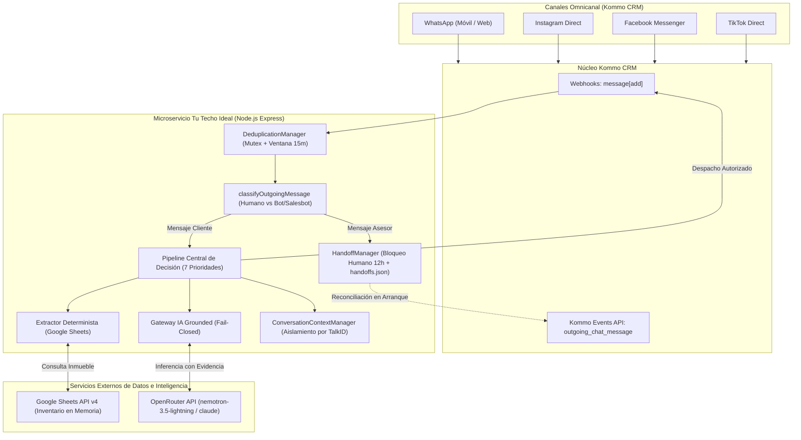
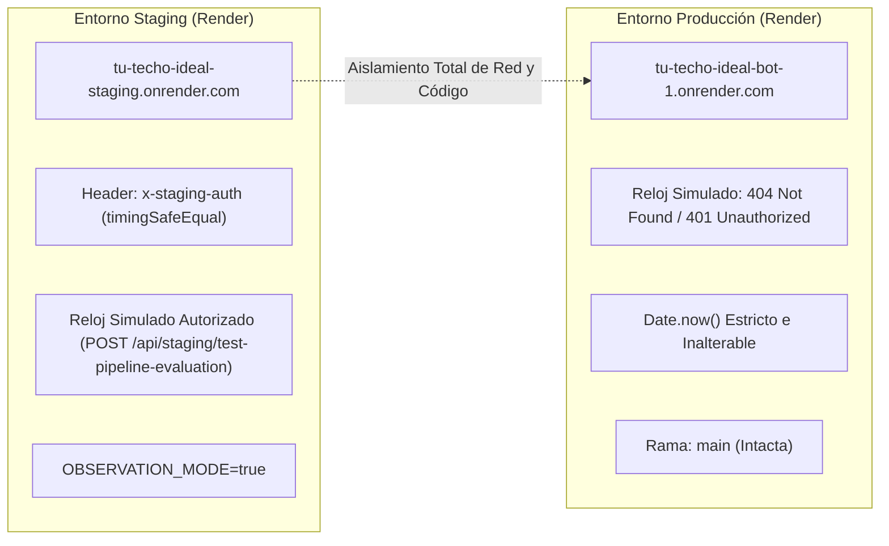

# ARQUITECTURA GENERAL E INTEGRACIONES — TU TECHO IDEAL V5.0

---

## 1. DIAGRAMA GENERAL DE ARQUITECTURA

---

## 2. FLUJO DETALLADO DE PROCESAMIENTO

### 2.1 Ingesta Omnicanal y Desduplicación
- Kommo CRM unifica las conversaciones de WhatsApp, Instagram, Facebook y TikTok.
- Los mensajes entrantes y salientes generan solicitudes webhook HTTP POST hacia el microservicio (`/webhook` o `/api/webhook`).
- **Mutex Lock & Deduplicación:** [`DeduplicationManager`](../pipeline_decision.js) procesa cada mensaje con un cerrojo por `message_id` y `talk_id`, descartando peticiones duplicadas y ráfagas de red en una ventana de 15 minutos.

### 2.2 Clasificación de Mensajes Salientes (`classifyOutgoingMessage`)
- Cuando se recibe un webhook de mensaje saliente (`outgoing_chat_message`), el sistema determina su origen:
  - **Asesor Web (`author.type === 'user'`, `created_by > 0`):** Intervención humana confirmada desde la interfaz de Kommo.
  - **Asesor WhatsApp Móvil (`created_by === 0`, texto manual no-bot):** Intervención humana desde el dispositivo móvil del asesor.
  - **Salesbot / Sistema / App (`author.type === 'bot' | 'system' | 'app'`):** Eco de respuesta automática generado por el propio bot o automatizaciones de Kommo. Se descarta para no activar falsos bloqueos.

### 2.3 Gestor de Bloqueo Humano (`HandoffManager`)
- Todo mensaje saliente de asesor humano activa un bloqueo de **12 horas exactas** (`hoursElapsed < 12`).
- **Persistencia en Disco:** El estado se persiste en `handoffs.json`.
- **Reconciliación en Vivo:** Al reiniciar el servicio o ante peticiones sin estado en memoria, el sistema consulta de inmediato la API de Eventos de Kommo (`/api/v4/events?filter[type]=outgoing_chat_message`) para recuperar la última intervención real, evitando que un reinicio desactive el bloqueo preventivo.
- **Falla Cerrada:** Si la API de Kommo no responde o devuelve error 500, el sistema asume que la conversación está bloqueada por precaución.

### 2.4 Pipeline de Decisión Centralizado (7 Prioridades)
Implementado en [`pipeline_decision.js`](../pipeline_decision.js):
1. **Prioridad 1 — Menciones y Redes:** Silencio absoluto sin consumo de IA ante menciones en historias o notificaciones de redes.
2. **Prioridad 2 — Bloqueo Humano:** Si `isLocked === true` (transcurridas < 12h), genera `SILENCE / HUMAN_LOCKED` de forma inmediata.
3. **Prioridad 3 — Citas / Negociación / Saludos Aislados:** Solicitudes de visita, negociación de precios o captación de inmuebles derivan en silencio a asesor humano. Saludos sin referencia inmobiliaria se dejan a atención humana.
4. **Prioridad 4 — Múltiples Inmuebles:** Si se detectan 2 o más códigos o enlaces Wasi en el mismo mensaje, se guarda silencio (`MULTIPLE_PROPERTIES`) para evitar cruce de información.
5. **Prioridad 5 — Enlace Wasi / Disponibilidad Canónica:** Verifica estatus en Google Sheets. Si está `"DISPONIBLE"`, responde la constante `"Bienvenido a Tu Techo Ideal, sí, disponible."` y fija el inmueble en el contexto.
6. **Prioridad 6 — Extracción Determinista desde Google Sheets (0 Tokens):** Para consultas directas de metraje, precio, habitaciones, baños y mantenimiento/condominio, extrae los datos de `DESCRIPCION_BREVE` mediante expresiones regulares estrictas y normalización numérica. Si la información no existe o es ambigua, guarda silencio absoluto (`PROPERTY_FEATURE_SIN_DATO`).
7. **Prioridad 7 — Consultas Complejas con IA (Grounded & Fail-Closed):** Pasa la consulta a OpenRouter exigiendo cita textual (`evidence`). Si la evidencia no existe textualmente en Google Sheets o el proveedor de IA falla (ej. HTTP 429), el bot guarda silencio total.

---

## 3. INTEGRACIÓN CON GOOGLE SHEETS
- **Acceso:** Utiliza Google Sheets API v4 mediante Service Account autenticado por credenciales JSON.
- **Caché en Memoria:** Mantiene una copia local indexada con TTL para responder en submilisegundos sin agotar cuotas de Google Cloud.
- **Normalización de Columnas:** Cumple con la estructura oficial de 13 columnas autorizadas (`CODIGO_WASI`, `ENLACE_PROPIEDAD`, `TITULO`, `TIPO_INMUEBLE`, `ESTATUS`, `OPERACION`, `PRECIO`, `METRAJE`, `HABITACIONES`, `BANOS`, `DESCRIPCION_BREVE`, etc.).

---

## 4. INTEGRACIÓN CON OPENROUTER
- **Modelo en Staging:** `nvidia/nemotron-3.5-lightning:free` / `anthropic/claude-sonnet-4.5`.
- **Mitigación de Límites de Cuota (HTTP 429):** Gracias al Extractor Determinista implementado en la Prioridad 6, el consumo de tokens de IA se redujo a 0 para las consultas inmobiliarias estándar más frecuentes (precio, área, habitaciones, baños, disponibilidad), desacoplando la estabilidad del servicio de las cuotas del proveedor de IA.

---

## 5. AISLAMIENTO Y SEGURIDAD ENTRE ENTORNOS

- **Guardián de Staging:** Rutas de auditoría y reloj simulado verifican `process.env.NODE_ENV === 'staging'` y el hostname exacto de Render.
- **Inviolabilidad de Producción:** El entorno de producción opera con `Date.now()` nativo inmutable. Cualquier parámetro como `simulated_now` u `offset_ms` es ignorado de raíz en los webhooks regulares.

